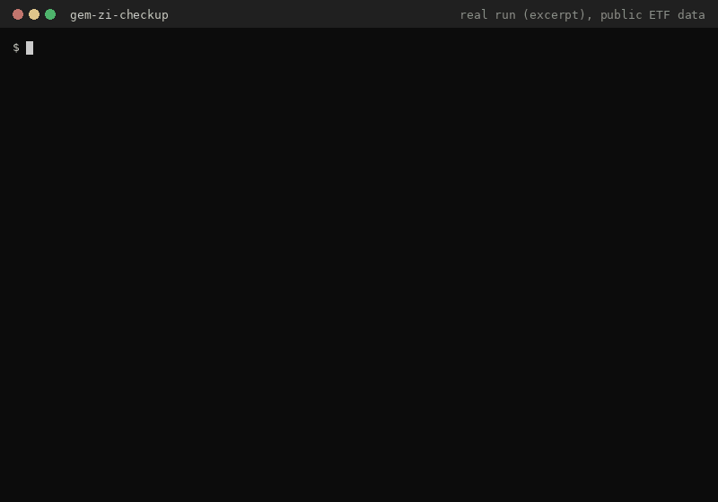

# GEM ZI Checkup

**Backtest of the Global Equity Momentum (GEM) ETF rotation strategy with real Polish broker costs: which IKE account, which rotation threshold (deadband), and whether more ETFs help, validated out-of-sample.**



<sub>Real run (excerpt) of `python run_all.py` on public Yahoo Finance prices, Oct 2026, without a GUS API key. Polish README with full results: [README.pl.md](README.pl.md).</sub>

## Why

GEM is a simple monthly rule: hold the risk asset with the strongest 12-month momentum, switch to bonds when momentum turns negative. On paper it beats buy-and-hold. In a real Polish account, currency conversion on every rotation, no fractional shares, commissions, slippage and the 19% capital-gains tax (outside IKE) eat a large part of that edge. This project answers three practical questions with numbers:

1. **Which broker?** XTB IKE vs BOSSA IKE vs mBank eMakler IKE vs a taxed account, with monthly contributions (DCA).
2. **Which deadband?** How much better must a new ETF's momentum be before a rotation pays for its costs?
3. **More ETFs?** Does adding gold, small caps or Europe ex-US (U5 vs U7 vs U9) improve net results?

## Quick start

```bash
git clone https://github.com/kamilkaczmareksolutions/gem-zi-checkup.git
cd gem-zi-checkup
pip install -r requirements.txt
cp .env.example .env        # set GUS_API_KEY (free, https://api.stat.gov.pl/Home/BdlApi) for CPI-indexed contributions
python run_all.py           # results/*.csv, results/*.png, results/decision_memo.md
```

The first run downloads prices from Yahoo Finance; later runs use a local cache.

## How it works

- **Strategy** (`src/momentum.py`): momentum = Price[t-1] / Price[t-13] - 1; best of CNDX / EIMI / IWDA if positive, otherwise best bond ETF (IB01 / CBU0); rotate only when the momentum gap exceeds the deadband, except on a risk-on / risk-off regime change.
- **Broker models** (`src/broker.py`, `spec_inputs.yaml`): FX cost per leg and on contributions, commission, slippage, fractional shares, currency sub-accounts, 19% Belka tax for the taxed account.
- **Simulation** (`src/backtest.py`, `src/metrics.py`): monthly DCA from zero capital, XIRR, Sharpe, Sortino, MaxDD, Calmar.
- **Pipeline** (`run_all.py`): data coverage check, baseline on 5 account models, deadband sweep (0-8%), in-sample calibration, walk-forward out-of-sample validation (60/24-month windows), timing-luck and FX-sensitivity tests, ETF universe comparison, contribution scenarios with CPI from the GUS API, and a final `decision_memo.md`.
- **Optional** `youtube_insights/` (`python -m youtube_insights`): pulls comments from a YouTube playlist (YouTube Data API) and ranks recurring investor questions with Gemini. Needs `YOUTUBE_API_KEY`, `GEMINI_API_KEY`, `YOUTUBE_PLAYLIST_ID`.

Full methodology: [METODOLOGIA.md](METODOLOGIA.md), assumptions: [assumptions.md](assumptions.md), latest committed recommendation: [results/decision_memo.md](results/decision_memo.md) (all in Polish).

## Limitations

- Simplified fee model: it does not reproduce every broker tariff threshold (for example XTB's monthly turnover limit). See the cost note in [README.pl.md](README.pl.md).
- Backtest only, on 2012+ LSE ETF history; IB01 starts in 2019, EIMI in 2014.
- Stage 7 (CPI-indexed contributions) needs `GUS_API_KEY`: without it and without cached CPI data the run stops at that stage.
- Docs, console output and the decision memo are in Polish.
- Educational project. Not investment advice.

## License

No license file yet: all rights reserved by the authors until one is added.
